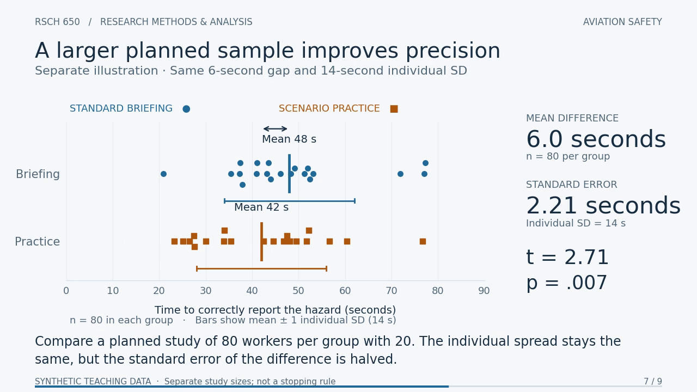
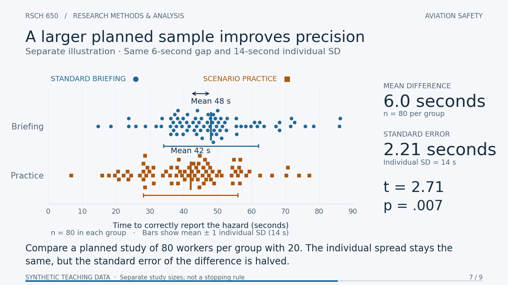

# Quality review

Initial review: 16 October 2026, covering the package as supplied from ChatGPT Work in [commit 8859fe6](https://github.com/stephenlewandowski/research-methods-analysis/commit/8859fe6d792650d1f9c4d1c67dc6ee9b716e8603).

## Resolution status

The two medium-priority findings below are resolved in the revised edition:

- **Chapter 7:** all 80 observations per group are plotted at their actual values from the first frame. The old-data crossfade and horizontal compression have been removed. Regression tests compare the rendered observations with the displayed sample size and statistics at the chapter start and during the scene. See the [corrected frame at 1:23](review/chapter-7-corrected.png).
- **Rebuild:** scripts resolve inputs relative to their own source directory and accept `--output-dir`. [BUILD.md](BUILD.md), pinned requirements, and `source/build.py` provide the complete generation, preview/poster, encoding, and packaging sequence.
- **SPSS worked example:** the [new lab](spss-worked-example/) develops independent and paired analyses. Both syntax files have run successfully in native IBM SPSS Statistics 29.0.2.0, with genuine output snapshots and numerical comparisons against independently computed references. The final video checklist now refers to independent workers/pairs and the relevant groups/differences.

The following findings and screenshots document the **original edition**. Original-source links refer to the import commit; the chapter-7 screenshots are retained as historical evidence, not images of the corrected video.

## Overall assessment

This is a useful instructor-led introduction to the independent two-sample t-test. Its completed-scene calculations, interpretation, synthetic-data labeling, and supporting teaching notes are strong. The graphics are coherent and readable at their intended desktop presentation size. It is a narrated-by-the-instructor video lesson, with chapter navigation rather than adjustable simulation parameters.

The original edition had two issues: chapter 7 temporarily displayed statistics that did not describe the points on screen, and the documented rebuild procedure did not match the delivered source layout. Both are corrected as described above. Neither changed the verified calculations for the completed examples.

## Findings

### 1. Resolved: chapter 7 paused on inconsistent points and statistics

At **1:23.000**, the larger-sample chapter shows the old **20 observations per group**, but its labels already say **80 per group**, SE = **2.21**, t = **2.71**, and p = **.007**. The visible old observations instead have SE = **4.43**, t = **1.36**, and p = **.183**. This is especially noticeable because the chapter button deliberately pauses at that exact time.

The original renderer immediately returns the final 80-person scenario in [render_ttest.py](https://github.com/stephenlewandowski/research-methods-analysis/blob/8859fe6d792650d1f9c4d1c67dc6ee9b716e8603/projects/t-test-teaching-package/source/render_ttest.py#L86), while [the scatter transition](https://github.com/stephenlewandowski/research-methods-analysis/blob/8859fe6d792650d1f9c4d1c67dc6ee9b716e8603/projects/t-test-teaching-package/source/render_ttest.py#L113) initially gives the old observations full opacity and the new observations zero opacity. During the transition, the new observations are also horizontally compressed while the displayed statistics use the uncompressed final data. The original completed display after approximately 2.4 seconds is correct.

The correction keeps the complete new observations, sample-size labels, and statistics synchronized from **1:23**. Advancing to 1:26 is no longer necessary in the revised video.

At 1:23:

At 1:26:

### 2. Resolved: the supplied rebuild instructions were incomplete

[The original README](https://github.com/stephenlewandowski/research-methods-analysis/blob/8859fe6d792650d1f9c4d1c67dc6ee9b716e8603/projects/t-test-teaching-package/README.txt#L17) says to change `OUT/out` to rebuild elsewhere. That does not resolve the original source-layout assumptions. The original packaging script reads the template from [the output root](https://github.com/stephenlewandowski/research-methods-analysis/blob/8859fe6d792650d1f9c4d1c67dc6ee9b716e8603/projects/t-test-teaching-package/source/package_ttest.py#L7), but the delivered template is in `source/`. It then tries to copy production scripts from [the output directory's parent](https://github.com/stephenlewandowski/research-methods-analysis/blob/8859fe6d792650d1f9c4d1c67dc6ee9b716e8603/projects/t-test-teaching-package/source/package_ttest.py#L37), whereas the supplied scripts also live in `source/`.

Changing the output path alone therefore leaves missing-input paths or a same-file copy problem, depending on the chosen layout. The package also lacks an executable build-order guide and a dependency/version file. This finding follows from inspecting the paths and file layout; the production pipeline was not executed or rebuilt during this review.

Recommended correction: resolve source inputs relative to each script's `__file__`, accept a separate output directory, use explicit UTF-8 encodings, and document the asset-generation, preview/poster, encoding, and packaging order with tested dependency versions and FFmpeg availability.

### 3. Addressed: paired-design scope and independence checklist

The original final scene correctly distinguishes independent groups from repeated measurements of the same workers but provides a conceptual comparison only. The new [SPSS lab](spss-worked-example/) now supplies a separate paired dataset, a worked paired statistic and confidence interval, and native-validated SPSS analysis centered on within-worker differences.

The original final screen's [checklist](https://github.com/stephenlewandowski/research-methods-analysis/blob/8859fe6d792650d1f9c4d1c67dc6ee9b716e8603/projects/t-test-teaching-package/source/render_ttest.py#L238) says “Independent observations” next to both designs. The revised checklist specifies independent workers/pairs and inspection of groups/differences, with skew/outlier checks. Within-worker observations remain related by design.

### 4. Lower priority: captions and lesson content could be easier to maintain

The burned-in captions, full text transcript, keyboard-accessible chapter controls, focus indicators, and chapter announcements are useful. The [video element](source/classroom_template.html#L45) has no selectable caption track, although a VTT file is supplied. An optional selectable or scalable text layer would improve learner control; avoid overlaying duplicate text on the burned-in captions. This optional enhancement remains open.

Scene timing and content are repeated in Python, the timeline, captions, and [the HTML navigation/transcript](source/classroom_template.html#L54). New regression checks detect timeline, chapter-start, and caption drift. The transcript and results prose still need editorial review when scene content changes.

## What works well

- Every observation is clearly synthetic. Exact engineered summaries are disclosed, and the notes do not treat the example as evidence about real aviation training.
- The lesson separates individual SD from the standard error of a mean difference and distinguishes overlapping individual values from uncertainty in group means.
- The p-value is correctly conditional on equal population means and the model assumptions. Nonsignificance is not presented as equivalence.
- The confidence interval is correctly interpreted as uncertainty about a population mean difference, not the distribution of individual outcomes. Operational importance is discussed separately from statistical evidence.
- Larger sample sizes are explicitly described as separate planned illustrations, avoiding an instruction to keep collecting data until significance is reached.
- Notes address independence, skew/outliers, missed detections, censoring, accuracy-speed tradeoffs, random assignment, and limits to generalization.
- The offline HTML contains the actual video and poster. There is no playback dependency on a CDN or remote data service.

## Initial verification record

### Statistical and data checks

All four asset scenarios were independently recalculated from their stored observations using sample-statistics formulas and numerical integration of the Student-t density, without running the supplied production scripts.

| Scenario | n/group | SE (s) | t | df | Two-sided p | 95% CI, briefing minus practice (s) |
| --- | ---: | ---: | ---: | ---: | ---: | --- |
| Baseline | 20 | 2.529822 | 2.371708 | 38 | .022875802 | [0.878643, 11.121357] |
| Larger gap | 20 | 2.529822 | 4.743416 | 38 | .000029494 | [6.878643, 17.121357] |
| More variability | 20 | 4.427189 | 1.355262 | 38 | .183335779 | [-2.962375, 14.962375] |
| Larger sample | 80 | 2.213594 | 2.710524 | 158 | .007460384 | [1.627947, 10.372053] |

The independent results agree with the stored SE, t, df, and p within 1e-12 and confidence bounds within 1e-10. CSV and SPSS data agree exactly row-for-row: 40 observations, 40 unique worker IDs, and 20 per group. CSV rounding differs from the full-precision assets by at most 4.98e-10 seconds. All 551 stored reference-density points agree with the t(38) density, and observations remain inside the common 0–90 second plotting domain.

At the initial review, the command structure matched the documented `T-TEST` subcommands but SPSS itself was not run. The follow-up revision now includes native SPSS 29 execution of both independent and paired analyses, genuine output snapshots, and an automated comparison with independently calculated references. See the [worked example](spss-worked-example/) and [native validation instructions](BUILD.md).

### Media and player checks

- FFprobe confirmed exactly **126 seconds**, H.264, **1280 × 720**, **15 fps**, **1,890 frames**, and a single video stream with **no audio**. A complete FFmpeg decode reported no errors.
- The embedded HTML video matches the standalone MP4 byte-for-byte. Its SHA-256 is `f48cd9ee4889c1c32cc5dd4f54eeba9254b4805339d3cecabb000cfb0a105a98`.
- Browser checks passed with networking disabled: metadata and playback, all nine chapter buttons, pause/seek behavior, current-chapter status, and no JavaScript exceptions or HTTP requests.
- The expanded transcript fit widths of 768, 360, and 320 pixels without horizontal overflow. The raster video should still be viewed at desktop or presentation size for readable chart labels; resizing the page does not enlarge text inside the video.
- Frames from all nine chapters were visually reviewed, with additional inspection of the chapter-7 transition and the standard-error scene. This was a targeted visual review, not a frame-by-frame inspection of all 1,890 frames.
- All nine SRT and VTT caption texts match the timeline. Their intervals are contiguous from 0 to 126 seconds; caption pacing is approximately 82–136 words per minute.

## Method references

- [NIST/SEMATECH: Two-Sample t-Test for Equal Means](https://www.itl.nist.gov/div898/handbook/eda/section3/eda353.htm).
- [IBM SPSS Statistics: T-TEST command reference](https://www.ibm.com/docs/en/spss-statistics/30.0.0?topic=reference-t-test).
- [IBM SPSS Statistics: T-TEST examples](https://www.ibm.com/docs/en/spss-statistics/30.0.0?topic=test-examples-t-command).
- [IBM SPSS Statistics: Paired-Samples T Test](https://www.ibm.com/docs/en/spss-statistics/30.0.0?topic=tests-paired-samples-t-test).
